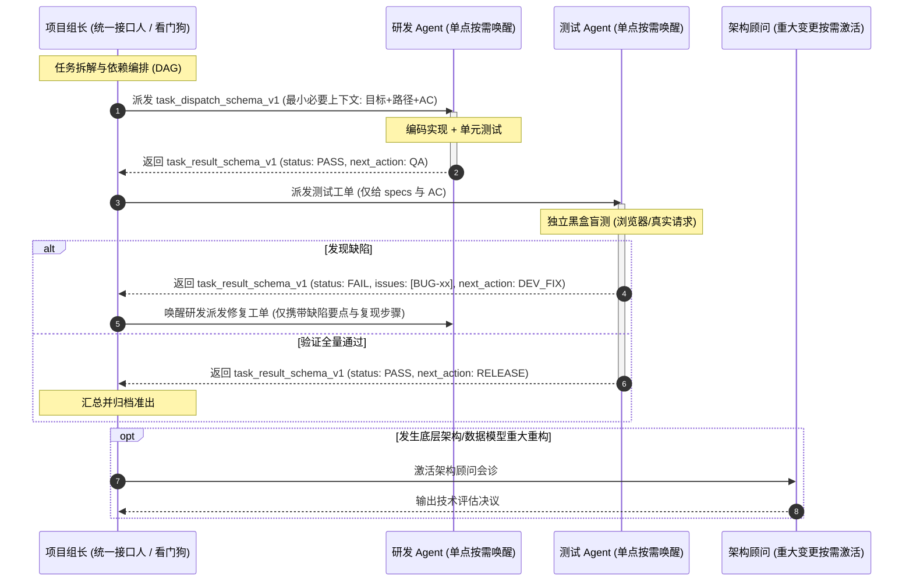

# Agent Task Orchestrator (多智能体协同研发调度器)

本项目方法论确立了一套**轻量化、按需唤醒、低上下文开销、强契约约束**的通用多 Agent 协同研发体系。通过标准化的 **输入契约 (`task_dispatch_schema_v1`)** 与 **统一返回契约 (`task_result_schema_v1`)**，彻底消除 Agent 之间信息传递的模糊性、断层与幻觉。

---

## 1. 角色轻量化分工体系

实施精准单点按需激活，拒绝无意义全员串联：

* **项目组长 (Lead / Coordinator)**：
  * **定位**：唯一对外统一接口人。
  * **核心职责**：专注任务拆解、按需派发与最终成果汇总。
  * **监视策略**：仅开启对下属执行者的**精简看门狗监视**（心跳检查与超时拦截），不越权介入具体代码编写。
* **执行专家（前端 / 后端 / 测试）**：
  * **定位**：特定任务交付者。
  * **调度原则**：**按实际任务单点、按需唤醒**。严禁进行全员连坐式无意义串联，单个任务完成即回归待命。
* **架构师与审查员 (Architect / Reviewer)**：
  * **定位**：专家顾问模式。
  * **介入时机**：日常编码、普通 Bug 修复不参与；仅在发生底层选型迁移、数据模型重大重构或核心安全协议变更时，由组长**按需唤醒会诊**。

---

## 2. 逻辑最小必要上下文规范

Agent 之间在逻辑上采用结构化最小必要上下文进行协作，推荐使用 JSON 或结构化 Markdown 表达，**不要求底层 Agent 框架必须以纯 JSON 作为强制物理通信协议，重在传递结构的精简与契约化**。

### 🚫 严禁行为（上下文防爆铁律）

1. **严禁复制粘贴完整历史聊天记录**（禁止让子 Agent 在海量无关对话中猜意图）。
2. **严禁全篇无脑粘贴 PRD 或全量架构设计总纲**（必须仅引用具体章节或提供明确文件路径）。
3. **严禁无过滤粘贴其他 Agent 的大段冗长终端日志**（必须仅提取核心报错堆栈或关键断言）。

### ✅ 优先传递黄金四要素：

> **`任务目标` + `对应文件路径` + `前置依赖状态` + `原子验收指标 (AC)`**

---

## 3. 标准化数据交互契约 (Data Contracts)

### ① Agent 标准输入协议：`task_dispatch_schema_v1`

组长向子 Agent 派发任务时的法定结构：

```json
{
  "$schema": "task_dispatch_schema_v1",
  "task_id": "TASK-2026-001",
  "target_role": "Backend_Engineer",
  "module": "Auth_Center",
  "dependencies": [
    "TASK-000_DB_INIT"
  ],
  "objective": "实现用户登录与双Token颁发",
  "input_contracts": {
    "specs": [
      "docs/specs/auth_spec.md"
    ],
    "contracts": [
      "backend/app/schemas/auth.py"
    ]
  },
  "constraints": {
    "no_mock": true,
    "no_contract_change": true,
    "no_scope_creep": true,
    "no_assumption": true,
    "source_of_truth": "input_specs",
  },
  "deliverables": {
    "code": [],
    "tests": [],
    "documentation": []
  },
  "acceptance_criteria": [
    "AC-01: 账号密码错误返回 40101 错误码",
    "AC-02: 登录成功返回 Bearer access_token 与 refresh_token"
  ]
}
```

#### 字段语义与执行约束：

* **`dependencies`**：前置任务依赖清单。若依赖项未处于全量 `PASS`，Agent 应拒绝执行并上报阻塞。
* **`input_contracts`**：输入依赖边界。`specs` 指向需求规约，`contracts` 指向类型/接口契约（DTO），禁止臆造入参。
* **`constraints`**：硬性执行规则。`no_mock: true` 严禁假数据；`no_contract_change: true` 禁止擅自变更已冻结契约。
* **`acceptance_criteria`**：原子化可验证的验收指标（AC 清单），作为判定交付的唯一准绳。

---

### ② Agent 统一返回协议：`task_result_schema_v1`

子 Agent 交付任务时的法定结构：

```json
{
  "$schema": "task_result_schema_v1",
  "task_id": "TASK-2026-001",
  "status": "PASS",
  "changes": [
    "backend/app/api/auth.py",
    "tests/test_auth.py"
  ],
  "validation": {
    "tests": "PASS",
    "acceptance_criteria": {
      "AC-01": "PASS",
      "AC-02": "PASS"
    }
  },
  "issues": [],
  "next_action": "QA"
}
```

#### 字段语义与路由约束：

* **`status`**：仅允许取值 `PASS`（全量达标）、`FAIL`（未达标）、`BLOCKED`（因依赖受阻）。
* **`changes`**：物理变更文件路径清单，杜绝遗留无用临时文件。
* **`validation`**：
  * `tests`：自动化测试执行结论（`PASS` / `FAIL`）。
  * `acceptance_criteria`：对输入派发中每一条 AC 条款的逐一映射判定（全部项均为 `PASS` 方可整体 `PASS`）。
* **`issues`**：若失败，列出缺陷编号或阻碍原因（如 `["BUG-01: 密码未散列"]`）。
* **`next_action`**：建议的下一步流转路由，常用枚举：`QA`（流转黑盒测试）、`DEV_FIX`（退回修改）、`RELEASE`（准出归档）。

---

## 4. 研发执行与质量准则

### 准则 1：Zero-Fake（真实性与零伪造）

* 当 `constraints.no_mock = true` 时，禁止编写静态假数据数组欺骗前端视图；禁止提供无真实网络/数据库动作的空 Toast 假按钮。
* 状态置为 `PASS` 必须具备真实的运行日志或 100% 通过的自动化测试支撑。

### 准则 2：双盲独立验证 (Double-Blind QA)

* 测试 Agent 独立运作，不带研发的白盒实现偏见，严格只依据 `specs` 和 `acceptance_criteria`，使用真实工具（如浏览器自动化）进行黑盒盲测。

### 准则 3：技术输出严谨去 AI 味

* 技术文档、提交信息与进度汇报拒绝“颠覆性”、“赋能”等宣传词，聚焦纯工程要素：架构拓扑、复现命令、入参出参、准出指标。

### 准则 4：路径安全与绝对锚定

* 文档内引用的多媒体资源一律使用纯英文字符路径（如 `docs/images/`），杜绝中文乱码截断 404。
* 文件型数据库（如 SQLite）连接路径在初始化代码中必须自动强制绝对路径锚定，防止终端工作目录差异导致误建空数据库。

---

## 5. 多 Agent 协同流转状态机



---

## 6. 标准化缺陷台账格式 (Defect Ledger Template)

当测试 Agent 在 `task_result_schema_v1` 中汇报 `status: FAIL` 时，`issues` 中的缺陷记录需满足以下规范结构：

```markdown
### 【BUG-编号】[级别: P0/P1/P2] [模块: 前端/后端/API] 简明缺陷标题
- **缺陷等级**：`P0 (阻断)` / `P1 (严重业务不符)` / `P2 (次要/样式)`
- **所属端与代码定位**：`front/src/views/...` 或 `backend/app/api/...`
- **规范偏离**：明确指出偏离的具体产品规格或 AC 条款
- **复现步骤**：
  1. 访问 / 发送请求 ...
  2. 执行操作 ...
  3. 观察到 ...
- **预期结果**：...
- **实际现象**：附带真实报错响应、堆栈或 TraceID
- **根因分析与整改建议**：定位缺陷成因并给出修复方向
- **回归验证状态**：`[待修复] -> [PASS/FAIL]`
```
