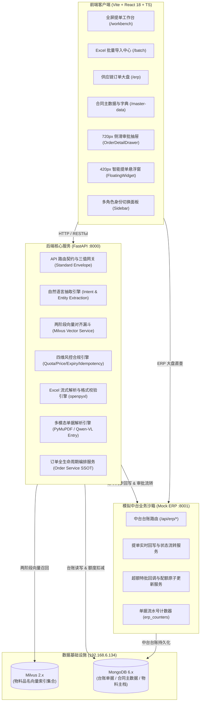

# TradeDoc AI (智能商贸提单助手)

<p align="center">
  
  
  
  
  
  
  
</p>

---

## 📖 项目简介 (Overview)

**TradeDoc AI（智能商贸提单助手）** 是一套面向大宗商品流通企业（涵盖钢材、管材、型材、板材与工业阀门等）的**智能化、多模态、合规驱动的商贸单据提单协同工作台**。

系统严格遵循大宗商贸业务规范开发，针对传统供应链提单场景中**“现场口语黑话多、提单要素分散、合同额度核算滞后、非标品名纠错成本高、ERP回写手工录入易错漏”**等行业痛点，构建了：
1. **多模态提单入口**：支持自然语言聊天提单、单据图片/PDF 智能 OCR 解析提取、Excel 批量表格拖拽解析；
2. **两阶段语义向量对齐漏斗**：基于 Milvus 向量相似度检索与商贸规则引擎，将工地现场非标黑话（如“18螺纹”、“10个厚中板”、“57管”）精准对齐为国家标准物资主档；
3. **四维硬性风控合规校验引擎**：合同有效期拦截、合同履约配额实时原子核算与超额硬拦截、价格偏离公允阈值预警、提单防重提交与幂等性控制；
4. **中台双向审批闭环**：嵌入底层供应链 ERP 大盘，提供 720px 侧滑审批抽屉（OrderDetailDrawer），支持业务主管在 ERP 视图进行超额特批裁决与配额终态扣减；
5. **双模态工作空间**：提单工作台支持一键缩小为常驻 ERP 沙箱右下角的 56px 悬浮球与轻量提单窗，并支持一键放大还原为全屏工作台。

---

## 🏛️ 系统架构 (Architecture)

系统采用前后端解耦、面向中台微服务演进的高内聚架构设计，所有业务接口严格遵循统一三值响应规范 (`code`: 200/400/500, `message`, `data`)：



---

## 🌟 核心特性 (Key Features)

### 1. 纯自然语言提单 (Natural Language SSOT)
- 输入口语化描述（如 `给中铁四局供200吨400E 20圆钢，走2026-WZ-101合同，单价4000元送相城工地`）；
- 自动提取关联合同、履约方、标段项目、规范品名、规格型号、数量单位、单价及送货地址；
- 自动填充业务属性：业务名称（`国内传统贸易`）、采购模式（`直发`）、业务标签（`传统贸易`）；
- 依据登录身份自动绑定经办人与所属部门。

### 2. 现场行业俗称与两阶段向量对齐 (Vector Alignment)
- **第一阶段（语义相似度粗筛）**：调用 Milvus 向量库对输入黑话计算余弦相似度（召回 Top-K 候选）；
- **第二阶段（规则漏斗精筛）**：基于物料编码规则库与规格归一化引擎，高精度映射至系统标准物料字典；
- 典型对齐覆盖：
  - `18螺纹` ➔ `MAT-STEEL-001` (热轧带肋钢筋 HRB400E Φ18mm)
  - `20圆钢` ➔ `MAT-STEEL-002` (热轧光圆钢筋 HPB300 Φ20mm)
  - `10个厚中板` ➔ `MAT-STEEL-005` (低合金高强度钢板 Q355B 10*2000*8000)
  - `57无缝管` ➔ `MAT-PIPE-001` (输送流体用无缝钢管 20# Φ57*3.5)
  - `DN50闸阀` ➔ `MAT-VALVE-001` (铸钢法兰闸阀 Z41H-16C DN50 PN16)

### 3. 四维硬性风控合规校验引擎 (Compliance Engine)
- **合同效期拦截**：关联合同若已过截止日期（如 `2025-WZ-012`），提单按钮强行锁定，绝对禁止提报；
- **履约额度硬拦截**：动态计算 `剩余额度 = 合同总额 - 累计已生效订单总额`。当订单金额超出剩余额度时，触发红色超额预警横幅，强行拦截常规提交，必须录入不少于 10 个汉字的特批申报理由进入特批审核流；
- **价格偏离预警**：订单单价超出公允指导价 +15% 自动触发黄色偏离预警；
- **幂等性与防重提交**：全流程携带 `Idempotency-Key`，提交后前端按钮立即 Loading 锁定，后端通过分布式防重机制杜绝重单。

### 4. 侧滑抽屉特批审批与中台回写 (Step 7 Drawer & Mock ERP)
- 供应链大盘中待特批订单点击“审核流转”，右侧平滑滑出 **720px 详情审批抽屉**；
- 抽屉内置 4 项动态指标看板（实时展示合同总额、已用额度、剩余额度、本次金额及超额差额）；
- 完整展示经办人特批申报理由卡片，提供快捷批注短语联动；
- 审批通过（`PASS`）后，订单状态流转为 `ACTIVE`/`AUDITED`，触发关联合同额度原子扣减；退回（`RETURN`）与驳回（`REJECT`）配额无损。

### 5. Excel 批量导入与原位纠错 (Batch Import Center)
- 提供标准 Excel 模板下载 (`TradeDoc_Order_Import_Template.xlsx`) 与拖拽上传；
- 逐行流式解析，正常行显示绿色【校验通过】，异常行高亮显示红色【异常预警】；
- 支持在前端表格中直接双击单元格就地微调纠错，校验状态即时转绿；
- 支持批量并发提交入库。

### 6. 提单工作台专属悬浮窗 (Dual-Mode UX)
- 彻底摒弃全站强制缩小卡片的错误逻辑，全站保持标准全屏 Web 现代布局；
- 提单工作台专属控制器：点击核验区顶栏“缩小为悬浮窗”，平滑导航至 ERP 大盘并唤起右下角 56px 悬浮球及 420px 提单轻量窗；
- 轻量浮窗顶栏“全屏”按钮支持无缝导航回完整提单工作台。

### 7. 多角色身份无感切换 (Multi-Role Support)
- 侧边栏左下角提供一键角色切换面板：
  - 🌟 **张明（业务经办人 · 物资贸易二部）**：全新用户，配额 1000 万全满，专属合同 `2026-WZ-101`（0 历史操作，适合全新闭环验证）；
  - 🏢 **李强（业务经办人 · 物资贸易一部）**：老用户，关联合同 `2026-WZ-089`（已超额，用于特批与拦截验证）；
  - ⚖️ **王建国（业务审批主管 · 华东风控部）**：专职在 ERP 大盘 720px 抽屉裁决特批单据；
  - 🛠️ **系统管理员（Admin · 运营保障中心）**：维护主数据台账与字典。

---

## 🛠️ 技术栈清单 (Tech Stack)

| 领域 | 核心技术 / 框架 | 选型说明 |
| :--- | :--- | :--- |
| **前端开发** | React 18, TypeScript, Vite 5 | 现代前端架构，组件化与严格类型推导 |
| **样式与动效** | TailwindCSS, Lucide React | 苹果风格现代 Web 规范 (HIG UI)，无缝自适应响应式 |
| **状态管理** | Zustand | 轻量级单源真相 (SSOT) 状态引擎 |
| **网络通信** | Axios | 统一请求拦截、统一三值业务码解包 |
| **后端开发** | FastAPI, Python 3.12, Uvicorn | 异步高性能 API 框架，ASGI 标准 |
| **数据校验** | Pydantic v2 | 严格 DTO 契约输入输出校验 |
| **数据库** | Motor (Async MongoDB Driver) | 异步驱动，用于单据与合同事务处理 |
| **向量检索** | PyMilvus | 大模型物料向量 Embedding 召回与语义距离计算 |
| **文档解析** | PyMuPDF (fitz), openpyxl | PDF 文本抽取与 Excel 表格流式解析 |
| **包管理工具**| uv | 新一代超高速 Python 依赖管理工具 |

---

## 🌐 端口与服务拓扑 (Ports & Topology)

| 服务名称 | 进程命令 / 容器 | 访问地址 | 默认端口 | 健康检查接口 (Probe) |
| :--- | :--- | :--- | :--- | :--- |
| **前端容器 (Frontend)** | `npm run dev` (Vite) | `http://127.0.0.1` | **5173** | `GET /` |
| **后端服务 (Backend)** | `uvicorn app.main:app` | `http://127.0.0.1` | **8000** | `GET /api/health` |
| **模拟中台 (Mock ERP)** | `uvicorn mock_erp.main:app` | `http://127.0.0.1` | **8001** | `GET /api/erp/health` |
| **业务数据库** | MongoDB 6.x | `192.168.6.134` | **27017** | `db: tradedoc_ai` |
| **向量数据库** | Milvus 2.x | `192.168.6.134` | **19530** | `collection: materials` |

---

## 🚀 快速启动指南 (Quick Start)

### 1. 环境准备
确保本机安装了：
- **Node.js** >= 18.0.0
- **Python** >= 3.10 (推荐 3.12)
- **uv** (推荐 `curl -LsSf https://astral.sh/uv/install.sh | sh`)

### 2. 依赖安装与启动

#### 启动后端核心服务 (Port: 8000)
```bash
cd backend
# 使用 uv 快速同步环境依赖
uv sync
# 启动 FastAPI 服务
.venv/bin/python -m uvicorn app.main:app --host 0.0.0.0 --port 8000 --reload
```

#### 启动模拟中台服务 (Port: 8001)
```bash
cd mock_erp
# 使用 uv 同步依赖
uv sync
# 启动 Mock ERP 服务
.venv/bin/python -m uvicorn mock_erp.main:app --host 0.0.0.0 --port 8001 --reload
```

#### 启动前端应用 (Port: 5173)
```bash
cd front
# 安装依赖
npm install
# 启动 Vite 开发服务器
npm run dev
```

### 3. 一键服务就绪探测
在终端运行验证三端连通性：
```bash
curl -s http://127.0.0.1:8000/api/health | jq .
curl -s http://127.0.0.1:8001/api/erp/health | jq .
curl -s -I http://127.0.0.1:5173/ | head -n 3
```

---

## 🧪 自动化测试与质量保障 (Testing)

项目采用“白盒契约测试 + 黑盒全链路穿刺”双重保障机制，严格遵循 **Zero-Fake 原则**，杜绝任何假数据兜底：

```bash
# 1. 运行后端白盒单测与 API 契约测试 (59项用例全部通过)
cd backend
.venv/bin/pytest tests/ -v

# 2. 运行端到端全链路业务穿刺测试 (13项核心业务闭环)
cd ..
backend/.venv/bin/python tests/blackbox_e2e_penetration.py

# 3. 前端生产构建静态检查
cd front
npm run build
```

### 自动化测试覆盖范围：
- **白盒测试用例**：`docs/测试/白盒/test_cases.md` (59/59 100% PASS)
- **白盒测试报告**：`docs/测试/白盒/test_report.md`
- **黑盒穿刺用例**：`docs/测试/黑盒/test_cases.md` (13/13 100% PASS)
- **黑盒穿刺报告**：`docs/测试/黑盒/test_report.md`
- **端到端闭环实操手册**：`docs/测试/完整闭环测试文档与步骤.md`

---

## 📂 项目目录结构 (Directory Layout)

```text
TradeDoc AI/
├── backend/                  # 后端核心业务工程 (FastAPI)
│   ├── app/
│   │   ├── middleware/       # 幂等性控制与日志中间件
│   │   ├── routers/          # API 路由 (parse, orders, contracts, master)
│   │   ├── schemas/          # Pydantic DTO 契约模型 (SSOT)
│   │   ├── services/         # 业务逻辑 (compliance, parser, semantic, order_service)
│   │   └── main.py           # 后端服务主入口
│   ├── tests/                # 白盒测试套件 (59 项测试)
│   └── pyproject.toml        # 后端依赖声明
├── mock_erp/                 # 模拟中台业务沙箱 (FastAPI)
│   ├── data/                 # 种子数据同步器 (initial_data.py)
│   ├── routers/              # 中台订单中心与主数据路由 (orders, master)
│   ├── schemas/              # 中台台账与回写数据结构
│   ├── main.py               # 中台服务主入口
│   └── pyproject.toml        # 中台依赖声明
├── front/                    # 前端工程 (React 18 + Vite + TS)
│   ├── src/
│   │   ├── components/       # 业务组件 (chat, compliance, document, draft, drawer, layout)
│   │   │   ├── drawer/       # 720px 侧滑审批抽屉 (OrderDetailDrawer)
│   │   │   ├── FloatingWidget.tsx # 420px 轻量级智能提单助手
│   │   │   └── layout/       # AppLayout, Header, Sidebar
│   │   ├── services/         # API 统一封装客户端 (api, orderApi, erpApi)
│   │   ├── stores/           # Zustand 状态单源真相 (useTradeStore)
│   │   ├── types/            # 前端 TypeScript 类型契约 (1:1 后端对齐)
│   │   ├── views/            # 核心业务大盘 (workbench, batch, erp, master)
│   │   └── App.tsx           # 前端根路由
│   └── package.json
├── data/
│   └── seeds/                # 业务主数据与种子文件 (contracts, materials, orders)
├── docs/                     # 架构规约与测试归档
│   ├── 00_source_requirements.md # 2.10 原始需求规格
│   ├── 01_prd.md             # 产品需求规格说明书 (PRD)
│   ├── 02_architecture.md    # 系统技术架构说明书
│   ├── 03_dev_guidelines_and_api_contracts.md # 接口契约说明书
│   ├── 05_mock_erp_design.md # 模拟中台沙箱架构设计
│   └── 测试/                 # 完整测试用例与测试报告 (白盒/黑盒/闭环实操手册)
├── tests/                    # 根目录端到端黑盒全链路穿刺脚本 (blackbox_e2e_penetration.py)
└── README.md                 # 项目根说明文档
```

---

## 📄 授权与归属 (License)

本项目专为大宗商品商贸供应链数字化提单场景研发。遵循商贸流通合规与内控审计规范。
