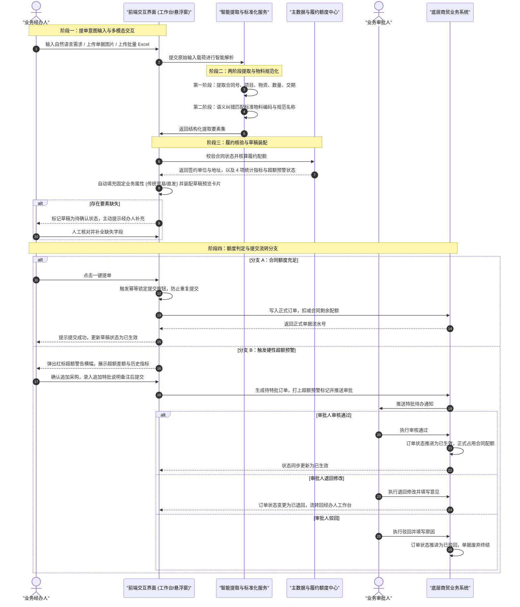
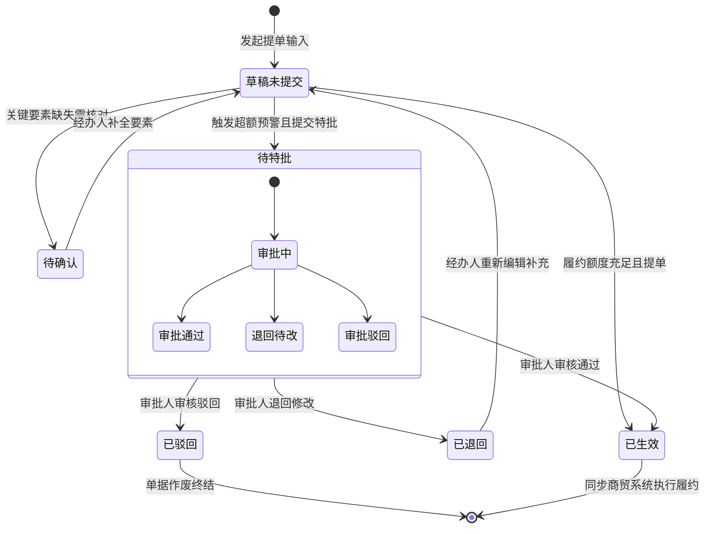

# 《智能商贸提单助手》产品需求规格说明书 (PRD)

| 文档版本 | 状态 | 编写人 | 适用范围 | 密级 |
| :--- | :--- | :--- | :--- | :--- |
| v1.0.0 | 正式发布 | 产品经理 (Product Manager) | 智能商贸提单系统产品研发与业务验收 | 内部公开 |

---

## 一、项目定位与业务目标

### 1.1 项目背景与业务痛点
在大宗商品及现代商贸流通场景中，传统的采销提单业务高度依赖人工手工录入与台账核算，存在以下典型业务痛点：
1. **录入链路冗长与沟通割裂**：业务一线多通过日常工作沟通软件发送零散文字、传真件发货签收单图片或线下汇总 Excel 提单，人工二次录入耗时费力且极易漏填错填。
2. **非标物料与手写简称歧义大**：现场单据存在大量俗称、简称、手写体（如“42.5 水泥”、“HRB400E 螺纹钢”等），不同项目现场习惯不一，极易与 ERP/商贸主数据中的标准物料编码脱节。
3. **履约额度核算滞后与超额风险敞口**：传统模式下合同已执行额度依赖财务或商务周期性清算，经办人提单时无法实时感知合同剩余订单数与金额配额，导致严重超额发货甚至合同履约纠纷。
4. **多系统频繁切换打断工作流**：经办人需在商贸订单列表、合同台账、沟通工具间反复横跳，缺少即开即用、与主业务系统无缝贴合的提单交互载体。

### 1.2 项目定位
**智能商贸提单助手 (TradeDoc AI)** 定位于面向大宗商品及商贸流通业务场景的智能化提单与履约风控协作平台。系统融合多模态自然语言理解、单据图像结构化识别、物料标准化映射与合同动态履约风控，打造“对话即提单、单据即数据、风控实时拦截、全屏悬浮一体”的现代化商贸提单体验。

### 1.3 核心业务目标与核心策略
1. **多模态智能提单**：全面覆盖“自然语言对话”、“单据图片识别”、“Excel 批量导入”三类业务输入，自动完成要素解析、属性补齐与物料编码校准。
2. **两阶段提单与物料标准化策略**：采用业务两阶段漏斗机制——第一阶段聚焦提取业务实体参数，第二阶段基于商贸标准物料库进行语义纠错与标准编码对齐，从机制上杜绝庞大物料库造成的提取混乱与上下文膨胀。
3. **合同履约前置风控**：构建合同履约动态核验体系，提单过程实时核算合同已下与剩余额度（订单数及金额），超额立即红标预警并阻断正常生效，支持通过追加说明转入特批审批流。
4. **前端双模态零损切换**：实现全屏提单工作台与商贸系统内嵌悬浮窗双模态运行，基于全局单源状态管理，确保草稿数据、输入流、指标卡片在形态切换时零延迟、零丢失。

---

## 二、用户角色与权限矩阵

### 2.1 角色职责与边界定义
系统严格基于商贸业务职责设立三类核心用户角色，严禁职责越界：

| 角色类型 | 核心职责说明 | 业务操作范围与权限边界 |
| :--- | :--- | :--- |
| **`业务经办人`** | 一线业务提单与草稿核实 | 1. 发起自然语言文本对话提单、快捷标签提单 2. 上传纸质签收单/磅单/合同图片并发起识别 3. 下载批量模板并上传 Excel 表格批量导入 4. 校验、微调与补充订单草稿必填字段 5. 提交正式订单或录入说明提交超额特批订单 6. 查询与回查本人及本部门所属商贸订单明细 |
| **`业务审批人`** | 合同履约合规审查与超额特批裁决 | 1. 查看流转至本部门的待审核/待特批订单详情 2. 重点核验合同履约配额占用、累计超额比例及经办人特批说明 3. 签署审批意见并执行审核通过（订单正式生效） 4. 执行退回修改（退回给经办人补充）或驳回作废 |
| **`系统管理员`** | 系统主数据底座运维与安全审计 | 1. 维护商贸合同主数据台账（编号、金额、签约单位等） 2. 维护标准化物资物料字典库与近义简称映射规则 3. 设定合同履约核验阈值规则与公允价风控参数 4. 配置智能提取服务调用运行参数 5. 检索与审计全量用户操作日志与单据追溯流水 |

### 2.2 权限控制与部门隔离矩阵
提单与提交操作强制校验用户当前登录态与组织架构归属部门，禁止跨部门越权操作单据：

| 功能模块 | 具体业务操作 | 业务经办人 | 业务审批人 | 系统管理员 | 数据隔离与权限控制规则 |
| :--- | :--- | :---: | :---: | :---: | :--- |
| **提单通道** | 发起对话提单 / 上传单据识别 | ✅ 允许 | ❌ 禁止 | ❌ 禁止 | 仅允许经办人发起；自动绑定当前登录人部门 |
| **批量提单** | Excel 模板下载 / 批量上传校验 | ✅ 允许 | ❌ 禁止 | ❌ 禁止 | 批量生成单据严格归属于经办人所在部门 |
| **草稿核验** | 编辑草稿 / 微调物资明细 | ✅ 允许 | ❌ 禁止 | ❌ 禁止 | 仅限修改本人创建且处于未生效状态的草稿 |
| **订单提交** | 一键正式提单（额度内正常单） | ✅ 允许 | ❌ 禁止 | ❌ 禁止 | 提交后锁定防重，生成正式单号并自动生效 |
| **超额申请** | 填写特批原因并提交待特批单 | ✅ 允许 | ❌ 禁止 | ❌ 禁止 | 触发超额预警时必填追加原因，方可提交特批 |
| **订单审批** | 审查特批单据 / 审批通过 / 驳回 | ❌ 禁止 | ✅ 允许 | ❌ 禁止 | 审批人仅可审批管辖部门范围内的超额特批单 |
| **订单查询** | 列表检索与详情抽屉查阅 | ✅ 本人/本部门 | ✅ 管辖部门 | ✅ 全量订单 | 强制按部门维度实行行级数据权限隔离 |
| **主数据维护**| 合同台账 / 物料字典 / 参数维护 | ❌ 禁止 | ❌ 禁止 | ✅ 允许 | 业务人员仅可读取引用，不可篡改主数据 |
| **审计追溯** | 查阅操作审计日志与追溯流水 | ❌ 禁止 | ❌ 仅限关联单 | ✅ 允许 | 记录操作人、原输入凭证哈希、时间戳 |

---

## 三、提单业务全景流程

---

## 四、三大提单通道功能规约

### 4.1 通道一：文本自然语言对话提单
1. **业务前置条件**：经办人成功登录系统且组织部门有效，打开全屏工作台或内嵌悬浮窗输入框。
2. **快捷引导操作**：输入区顶部常驻业务快捷标签：
   - `新建销售订单`：点击后预置销售意图对话模板，引导录入客户、项目及销售物资。
   - `新建采购订单`：点击后预置采购意图对话模板，引导录入供应商、合同及采购物资。
   - `继续上次`：快速载入当前经办人上一笔未完成的暂存草稿会话。
   - `使用帮助`：展示提单语义输入范例、支持的标准品类及操作指引。
3. **提取要素清单与业务映射**：
   - 自然语言提取要素：合同编号、工程项目名称、物资品名、规格型号、主计量吨数（数量）、期望交货期。
   - 自动绑定经办主体：依据当前登录账号自动关联经办人姓名、所属经办部门、创建人及当前系统时间。
   - 自动填充固定属性：系统强制自动填充业务名称为“国内传统贸易”、采购模式为“直发”、业务标签为“传统贸易”，无需人工反复填写。
4. **缺失提示与智能澄清**：
   - 当提取要素缺失关键必填项（如缺少合同号、物资品名不明确、吨数缺失等）时，订单草稿预览区高亮标红并置为“待确认”状态。
   - 对话交互流中，系统以对话气泡形式主动向经办人发起澄清追问（例如：“已为您提取到 200 吨 HRB400E 螺纹钢，请补充该笔订单所对应的合同编号及期望到货日期”）。
5. **异常边界规约**：
   - 意图完全无关内容：系统温和提示“未识别到有效的商贸提单意图，请参考示例或点击快捷标签发起提单”。
   - 数量非法（负数、文本非数值）：提示“物资数量需为大于 0 的数值，请重新输入”。
   - 交期早于当前提单日期：系统标黄提示“期望交期早于当前时间，请核实是否录入历史补单”。

### 4.2 通道二：单据图片 OCR 结构化提单
1. **业务前置条件**：支持发货签收单、现场磅单、正式商贸合同等纸质凭证的实拍照片或扫描件。
2. **提取要素清单**：物资名称、品牌规格、数量/净重、到货签收单位、发货/签约日期。
3. **物料语义纠错与标准化规约（两阶段机制）**：
   - 现场单据常见大量手写体模糊字迹、简称俗称（如将“HRB400E \(\Phi\)20 螺纹钢”简写为“400E 20圆钢”或将“普通硅酸盐水泥 42.5”简写为“42.5 水泥”）。
   - 系统完成文字抽取后，自动调用标准化物料词库进行语义校准与近义匹配，自动匹配出唯一的系统标准物料编码（如 `STL-RB-400E-20`）与规范物资全称。
4. **识别卡片与草稿装配**：
   - 识别完成后，在交互区左侧输出“单据识别提取卡片”，展示提取的原始文本片段与校准后的标准要素。
   - 右侧草稿预览区同步装配生成订单草稿，针对置信度存疑或未完全匹配项高亮标注，经办人可核对修正。
5. **异常边界规约**：
   - 图片清晰度过低/无法辨识：提示“单据文字模糊无法结构化提取，请重新上传清晰正向拍摄凭证”。
   - 物料无法匹配标准库：物料明细标注“未匹配标准编码”，强制要求经办人手动于下拉字典中选取标准物料。

### 4.3 通道三：Excel 表格批量解析提单
1. **业务前置条件**：经办人进入全屏工作台“批量导入与数据中心”页，下载系统官方标准模板。
2. **导入与解析规约**：
   - 支持经办人将填写好的 Excel 文件直接拖拽至上传区域或点击文件选择上传。
   - 系统按行并发解析表格数据，逐行提取合同编号、工程项目、标准物料编码/品名、规格、数量、单价、交期等。
3. **批量校验与红标预警机制**：
   - 解析完成后界面实时渲染“批量明细校验工作台”。
   - 逐行校验业务逻辑（包括合同编号有效性、物料编码匹配、必填项完整性、行金额计算）。
   - **正常行**：以绿色或标准中性色标注“校验通过”，展示解析出的明细数据。
   - **异常行**：整行高亮标红，并在行状态列显著显示“预警原因”（如“合同 2026-WZ-999 不存在”、“单价不可为空”、“数量必须大于0”）。
4. **单行微调与批量并发提交**：
   - 经办人可直接在校验表格的异常单元格中就地双击编辑微调，修改后系统即时触发单行复验，复验通过自动摘除红标。
   - 经办人确认全量或勾选有效行后，点击“批量提交”按钮，系统并发写入底层商贸订单，按行生成独立的正式商贸单据流水号，并实时回显提交进度与结果清单。
5. **异常边界规约**：
   - 表头格式不符合规范：整表拦截提示“文件表头与系统标准模板不一致，请下载最新模板重新填报”。
   - 空文件或有效数据为 0 行：阻断提交并提示“上传文件中未检测到有效的订单明细记录”。

---

## 五、履约核验与超额特批流转机制

### 5.1 合同履约配额核验体系
系统强制与商贸合同主数据台账联动，提单全流程实时计算并动态更新以下 **4 项履约核算统计指标**：

| 指标名称 | 业务含义 | 计算逻辑 / 数据来源 |
| :--- | :--- | :--- |
| **`合同累计已下订单数`** | 该合同项下历史已生效订单总数 | 统计该合同已提交且处于“已生效”状态的历史商贸单据总笔数 |
| **`累计已下金额`** | 该合同项下历史已占用的累计总金额 | \(\sum (\text{历史各有效订单明细总金额})\) |
| **`剩余可下订单数`** | 该合同根据约定的订单上限剩余配额 | \(\text{合同约定最大提单笔数} - \text{合同累计已下订单数}\) |
| **`剩余可下金额`** | 该合同当前实际剩余可提单可用额度 | \(\text{合同总金额} - \text{累计已下金额}\) |

### 5.2 超额判定规则与警告机制
1. **订单金额核算**：
   - 订单草稿总金额（本次占用金额）计算公式：
     \[
     \text{本次占用金额} = \sum_{i=1}^{n} (\text{明细物资数量}_i \times \text{含税单价}_i)
     \]
2. **合规性判定**：
   - **情况一：额度充足（合规订单）**
     - 当满足：\(\text{本次占用金额} \le \text{剩余可下金额}\) 且 \(\text{剩余可下订单数} \ge 1\) 时，判定为“额度合规”。
     - 界面展示绿色“额度充足”胶囊，经办人点击“一键提单”后，系统锁定防重并直接生成已生效订单。
   - **情况二：额度超出（超额预警订单）**
     - 当满足：\(\text{本次占用金额} > \text{剩余可下金额}\) 或 \(\text{剩余可下订单数} \le 0\) 时，判定为“硬性超额预警”。
     - 界面草稿顶部立即弹出红底白字高能警告横幅，明确展示：
       > **⚠️ 合同履约严重超额预警**  
       > 合同编号：`2026-WZ-089` ｜ 剩余可用额度：`¥ 150,000.00` ｜ 本次申请金额：`¥ 220,000.00` ｜ **超额差额：¥ 70,000.00 (超额比例 46.7%)**
     - 禁用标准“一键提单”直接生效入口，强制切换为“提交特批申请”入口。

### 5.3 超额特批申请与审批流转
1. **经办人申请与说明录入**：
   - 经办人必须复核订单超额事实。若确属项目现场临时追加采购或合理增量，经办人必须在草稿区弹出的“追加特批说明”输入框中填写说明（必填，字数不少于 10 字，如“经现场中建八局项目经理张总确认，科技城一号工地因工期提前追加 200 吨钢材”）。
   - 经办人点击“提交特批申请”，系统锁定草稿并生成状态为“待特批”的单据。
2. **业务审批人流转裁决**：
   - 审批人在待办列表中查阅该单据，界面重点高亮展示“合同已下额度看板”、“本次超额差额”以及经办人录入的“追加特批说明”。
   - **审核通过**：审批人签署通过意见，订单状态流转为“已生效”，系统扣减合同额度并正式同步至底层商贸业务系统。
   - **退回修改**：审批人填写退回修改意见（如“请补充项目业主签收联后再报”），订单状态变更为“已退回”，经办人可重新编辑草稿补充材料后再次提交。
   - **审批驳回**：审批人签署驳回意见（如“超额比例过高且未补充增补合同协议”），订单状态变更为“已驳回”，单据废弃作废，不再占用额度。

### 5.4 防重提交与单据幂等控制
1. **防重机制**：经办人点击提单或特批按钮瞬间，前端立即禁用提交按键并呈现 Loading 状态，防止网络抖动或高频点击产生重复单据。
2. **唯一商贸单据流水号规约**：单据正式入库时由系统依据统一业务编码规则派发唯一单号：
   - 编码规则：`[单据类型代码]-[经办单位代码]-[年月日(YYYYMMDD)]-[日自增三位流水号]`
   - 示例：`XSDD-WZGS-20260318-001`（销售订单-物资公司-2026年3月18日-第001单）。

### 5.5 订单全生命周期状态流转机 (Mermaid)

---

## 六、前端双模态交互规格

### 6.1 双模态理念与全局单源真相
系统支持在以下两种界面模式间平滑切换，满足一线人员不同业务场景的诉求：
- **全局单源真相原则**：全屏工作台与内嵌悬浮窗在底层共享同一套草稿与会话上下文状态。不论用户在全屏还是悬浮窗中输入文字、上传单据、修改明细或暂存草稿，切换交互容器时视图数据**100% 实时同步、无缝保留、零延迟、零丢失**。

### 6.2 模式一：全屏提单工作台 (Fullscreen Workbench)
1. **适用场景**：深度提单作业、复杂多物资明细录入、批量 Excel 导入、多维度履约比对分析。
2. **界面结构规约（左右双栏布局）**：
   - **左侧：多模态提单交互区**
     - 顶部：提单模式 Tab 切换栏（`文本对话提单`、`单据图片识别`、`Excel 批量导入`）。
     - 快捷操作区：快捷操作标签横向胶囊（`新建销售订单`、`新建采购订单`、`继续上次`、`使用帮助`）。
     - 会话流展示区：滚动呈现经办人与 AI 提单助手的多轮交互消息气泡、意图澄清卡片。
     - 底部输入工具栏：多功能文本输入框、发送按钮、单据上传入口及清空会话按键。
   - **右侧：订单草稿预览与核验区**
     - 顶部状态栏：草稿状态胶囊（`草稿未提交` / `待确认` / `待特批` / `已生效`）与窗口切换控制器（“缩小为悬浮窗”按钮）。
     - 履约额度指标看板：并排展示 4 个指标统计卡片（合同累计已下订单数、累计已下金额、剩余可下订单数、剩余可下金额）。
     - 预警横幅区：仅在额度超额时弹出红色警告横幅，展示超额差额与警示文案。
     - 基本信息网格卡片：分栏展示单据类型、合同编号、签约单位、工程项目、收货地址、业务名称、经办人等。
     - 物资明细表格区：清晰表格展示序号、标准物料编码、规范物资名称、品牌规格、数量、单位、含税单价、总金额。
     - 底部操作栏：暂存草稿按钮、一键提单按钮 / 提交特批申请按钮。

### 6.3 模式二：商贸系统内嵌悬浮窗 (Floating Widget)
1. **适用场景**：经办人在商贸业务系统（如 ERP 销售/采购订单列表）处理日常工作时，无需离开当前页面即可随时唤起提单。
2. **界面结构与交互规约**：
   - **常驻悬浮球**：默认停靠在商贸业务系统网页右下角，带有“智能提单助手”呼吸态微动效与角标提示。
   - **展开悬浮窗**：点击悬浮球后平滑滑出轻量提单浮窗（约 420px 宽度）。浮窗内保留轻量多轮对话、快速单据上传以及精简版草稿摘要卡片。
   - **顶部操作栏**：包含“放大至全屏工作台”图标按钮、“最小化收起”图标按钮。
   - **业务列表联动**：当经办人在悬浮窗中完成订单提单后，底层商贸系统的订单列表即时触发自动静默刷新，新订单即刻呈现在首行；点击列表行可直接滑出“订单详情抽屉”查验单据完整主档与明细。

### 6.4 双模态切换行为规则
- **悬浮窗 -> 全屏工作台**：点击悬浮窗右上角“全屏”按钮，页面路由过渡至全屏工作台，当前会话消息、未提交草稿、已上传图片识别结果无损投射至全屏工作台。
- **全屏工作台 -> 悬浮窗**：点击全屏工作台右上角“缩小为悬浮窗”按钮，界面返回底层商贸订单列表，右下角悬浮窗保持展开状态，且草稿内容完好保全。

---

## 七、单据业务主档与明细字段字典

### 7.1 订单结构化主档 (Order Header)

| 业务字段名称 | 英文字段标识 | 字段分类 | 业务数据类型 | 必填 | 默认值 / 生成规则 | 业务说明与校验规则 |
| :--- | :--- | :--- | :--- | :---: | :--- | :--- |
| **单据流水号** | `order_no` | 标识信息 | 文本字符 | 是 | 系统规则自动生成 | 格式：`XSDD/CGDD-经办单位-年月日-流水号`，全系统全局唯一 |
| **单据业务类型** | `order_type` | 基础属性 | 枚举编码 | 是 | 用户指定/意图抽取 | 枚举值：`SALES` (销售订单), `PURCHASE` (采购订单) |
| **合同编号** | `contract_no` | 履约关联 | 文本字符 | 是 | 意图提取/人工输入 | 必须对应合同台账主数据中真实有效且未终止的合同 |
| **签约往来单位** | `counterparty_name` | 签约主体 | 文本字符 | 是 | 关联合同自动带出 | 销售为客户名称，采购为供应商全称，支持人工二次核验 |
| **工程项目名称** | `project_name` | 业务关联 | 文本字符 | 是 | 意图提取/合同关联 | 归属工程项目或标段名称，长度 2~100 字符 |
| **收货详细地址** | `delivery_address` | 物流履约 | 文本字符 | 是 | 提取/主数据带出 | 施工现场或指定仓库详细地址，不可为空 |
| **现场联系人** | `contact_person` | 物流履约 | 文本字符 | 否 | 提取/人工补充 | 项目现场收货人姓名及联系电话 |
| **业务名称** | `business_name` | 业务属性 | 文本字符 | 是 | `国内传统贸易` | 固定默认填充，商贸分类规范属性 |
| **采购模式** | `procurement_mode` | 业务属性 | 文本字符 | 是 | `直发` | 固定默认填充，大宗物资直发到工地模式 |
| **业务标签** | `business_tag` | 业务属性 | 文本字符 | 是 | `传统贸易` | 固定默认填充，标识单据业务性质 |
| **经办人姓名** | `operator_name` | 经办主体 | 文本字符 | 是 | 登录上下文自动绑定 | 当前操作人真实姓名，禁止前端篡改 |
| **经办部门** | `operator_dept` | 经办主体 | 文本字符 | 是 | 登录上下文自动绑定 | 经办人所属组织部门，用于行级权限隔离 |
| **创建时间** | `created_at` | 审计追踪 | 时间戳 | 是 | 系统当前时间戳 | 单据创建并入库的实际业务时间 |
| **订单生命周期状态** | `order_status` | 业务流转 | 枚举编码 | 是 | `DRAFT` | 枚举值：`DRAFT` (草稿未提交), `PENDING_CONFIRM` (待确认), `PENDING_SPECIAL_APPROVAL` (待特批), `ACTIVE` (已生效), `RETURNED` (已退回), `REJECTED` (已驳回) |
| **超额预警标记** | `is_over_quota` | 履约风控 | 布尔型 | 是 | `false` | 当本次金额超出合同剩余额度时置为 `true` |
| **追加特批说明** | `special_approval_reason`| 履约风控 | 长文本 | 条件必填 | 空 | 当触发超额预警（`is_over_quota = true`）时必填，不少于 10 字 |

### 7.2 物资产品明细表 (Order Items)

| 业务字段名称 | 英文字段标识 | 业务数据类型 | 必填 | 来源与生成方式 | 业务说明与校验规则 |
| :--- | :--- | :--- | :---: | :--- | :--- |
| **行序号** | `item_seq` | 整数数值 | 是 | 系统自增生成 | 明细排序序号，从 1 开始递增 |
| **标准物料编码** | `material_code` | 文本字符 | 是 | 物料库语义纠错匹配 | 必须对齐系统物料标准主档编码（如 `STL-RB-400E-20`） |
| **规范物资名称** | `material_name` | 文本字符 | 是 | 标准物料库主档带出 | 经过标准化校准后的规范品名，如“热轧带肋钢筋” |
| **品牌规格型号** | `specification` | 文本字符 | 是 | 提取/物料库匹配 | 物资规格、牌号，如“HRB400E \(\Phi\)20mm” |
| **主计量数量** | `quantity` | 浮点数值 | 是 | 提取/人工输入/导入 | 物资开单数量/吨数，必须为大于 0 的数值，保留 3 位小数 |
| **主计量单位** | `unit` | 文本字符 | 是 | 物料主数据带出 | 物资计量单位，如“吨”、“件”、“张” |
| **含税单价** | `unit_price` | 浮点数值 | 是 | 合同价/人工核定 | 销售或采购含税单价（元），必须大于 0，保留 2 位小数 |
| **行总金额** | `total_amount` | 浮点数值 | 是 | 自动公式核算 | 公式：\(\text{quantity} \times \text{unit_price}\)，系统自动计算 |
| **履约执行进度** | `fulfillment_progress` | 百分比 | 否 | 统计核算分析 | 该品类在当前合同项下的累计发运/交付履约百分比 |

### 7.3 合同履约配额看板字典

| 业务指标名称 | 英文标识 | 字段属性 | 格式要求 | 业务说明 |
| :--- | :--- | :--- | :--- | :--- |
| **合同总金额** | `contract_total_amount` | 基础金额 | 货币格式保留2位小数 | 所属合同签订的法律效力总上限金额 |
| **累计已下订单金额** | `accumulated_order_amount`| 统计金额 | 货币格式保留2位小数 | 历史所有已生效订单金额之和 |
| **累计已下订单笔数** | `accumulated_order_count` | 统计数量 | 正整数 | 历史所有已生效订单总笔数 |
| **本次申请占用金额** | `current_order_amount` | 动态金额 | 货币格式保留2位小数 | 当前草稿中全部明细行金额总和 |
| **剩余可用额度** | `remaining_quota_amount` | 动态额度 | 货币格式保留2位小数 | 合同总金额 - 累计已下金额 |
| **剩余可下订单数** | `remaining_order_count` | 动态配额 | 整数（允许负数） | 约定最大单数 - 累计已下订单数 |
| **配额风控状态** | `quota_status` | 风险标签 | 枚举（`NORMAL` / `OVER_QUOTA`） | 标识当前单据是否处于安全额度内 |

### 7.4 操作审计与追溯流水档案 (Audit Trail)

| 业务字段名称 | 英文标识 | 字段属性 | 业务说明与追溯价值 |
| :--- | :--- | :--- | :--- |
| **追溯流水编号** | `trace_id` | 文本字符 | 每次操作唯一分配的业务追溯流水号 |
| **操作用户** | `operator` | 账户标识 | 记录当前操作人工号、姓名与所属部门 |
| **操作行为动作** | `action_type` | 枚举动作 | `DRAFT_SAVE` (草稿暂存), `OCR_EXTRACT` (单据识别), `EXCEL_IMPORT` (批量导入), `ORDER_SUBMIT` (正式提单), `SPECIAL_SUBMIT` (特批提报), `APPROVAL_PASS` (审批通过), `APPROVAL_RETURN` (审批退回), `APPROVAL_REJECT` (审批驳回) |
| **输入凭证指纹** | `input_payload_hash` | 摘要散列 | 原始提单对话文本摘要或上传单据图片文件指纹，确保业务溯源不可篡改 |
| **关联商贸单号** | `order_no` | 单据索引 | 产生关联的正式单据编号或草稿临时单号 |
| **操作时间戳** | `timestamp` | 日期时间 | 精确到毫秒的标准业务发生时间戳 |

---

## 八、业务异常提示与边界处理清单

系统在全链路贯彻“友好提示、清晰引导、防错防漏、风险前置”的交互设计规范，建立如下业务异常与边界处理矩阵：

| 异常类别 | 触发具体业务场景 | 系统前端业务表现与提示 | 业务处置措施与恢复规则 |
| :--- | :--- | :--- | :--- |
| **输入解析异常** | 经办人输入的自然语言与商贸业务完全不相干 | 对话气泡提示：“未检测到有效的商贸提单内容，请提供合同号、物料品名及数量，或点击快捷标签发起。” | 保持草稿区不变，光标聚焦输入框，引导输入合规语句 |
| **要素缺失异常** | 提取出的信息缺少合同编号或交货地点 | 草稿区顶部胶囊置为黄底“待确认”；缺失字段单元格红框高亮；对话助手主动提问补充 | 经办人可直接在对话中回答补充，或直接在草稿右侧表单双击手动填入 |
| **物料非标异常** | 单据上物料为生僻手写简称，未能匹配到标准库 | 明细表物料编码列高亮黄标显示“待匹配标准编码”；提示：“检测到非标物料简称，请在下拉字典中人工选定” | 经办人双击该行物料单元格，从商贸标准物料库下拉列表中手动选择确认 |
| **单据识别异常** | 上传图片分辨率极低、严重反光或非单据类图片 | 交互面板提示：“单据图像模糊或未识别到有效文字凭证，请核对后重新上传高清原图” | 中断当前识别流，清空上传预览框，允许经办人重新选图上传 |
| **批量表格异常** | 经办人上传的 Excel 包含空行、乱码或表头缺失 | 校验表格整行标红，行状态列明确提示“第 X 行：合同号格式非法且单价未录入” | 经办人可在页面直接双击异常单元格就地修正，复验通过自动恢复绿标 |
| **履约超额异常** | 当次订单总金额超出合同剩余可下额度 | 界面顶部弹出红色警示横幅，展示超额差额；阻断“直接生效”提单，点亮“提交特批申请”入口 | 经办人必须复核，且在“追加特批说明”中输入不少于 10 字的原因方可提交 |
| **权限越界异常** | 经办人试图操作非本人且非本部门管辖的单据草稿 | 页面弹出拦截提示：“无权操作非本部门单据，已记录操作合规日志” | 阻断加载并返回经办人本人的订单看板 |
| **会话失效异常** | 经办人长时间未操作导致系统登录态失效 | 弹出安全提示：“登录凭证已失效，为保障商贸数据安全，系统已为您暂存当前草稿，请重新登录” | 本地暂存当前未提交草稿，唤起登录弹窗，登录成功后原位恢复数据 |
| **网络防重异常** | 经办人短时间内连续快速点击“一键提单”按钮 | 提交按钮在首次点击瞬间进入置灰 Disable 状态，并显示 Loading 状态 | 前端幂等锁定，等待单据流水号生成并落盘后刷新页面，杜绝生成双重单据 |
