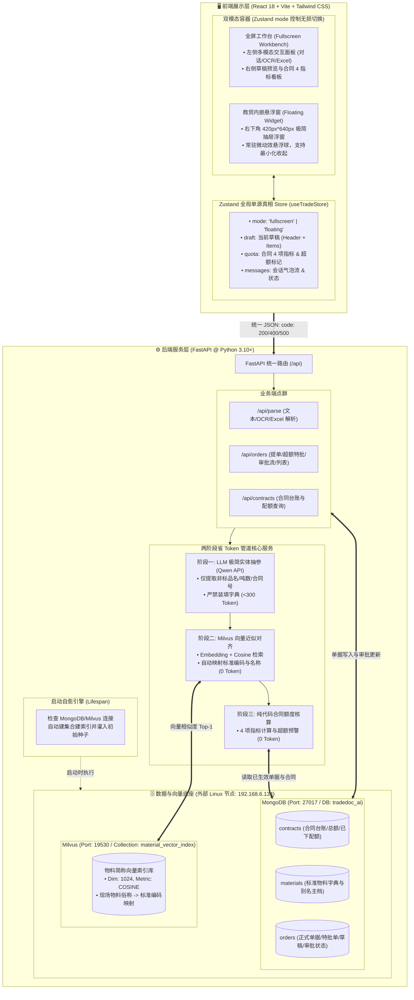
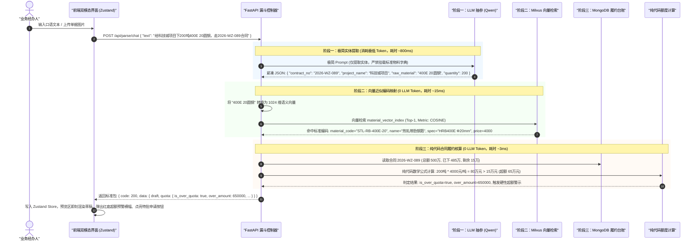

# 《智能商贸提单助手 (TradeDoc AI)》系统架构与技术设计规约 (MVP Slim Spec)

| 文档版本 | 状态 | 编写人 | 适用范围 | 密级 |
| :--- | :--- | :--- | :--- | :--- |
| v2.0.0 (MVP) | 正式发布 | 系统架构师 (Architect Agent) | 智能商贸提单助手全栈敏捷研发、数据对齐与业务验收 | 内部公开 |

---

## 一、系统极简分层拓扑

### 1.1 架构设计理念与原则
针对大宗商贸采销提单场景，本架构坚持**“轻量、精悍、直奔业务跑通”**的极简 MVP 路线，**彻底剔除 LocalStorage 频繁防抖冷备、崩溃逃生序列化、12 类复杂状态码等过度设计包袱**，同时 **100% 完整保留 2.10 需求的全部核心业务功能**：
1. **两阶段省 Token 原生漏斗**：LLM 仅提取实体参数（< 300 Token），标准物料对齐交由 Milvus 向量近似检索（0 Token），合同履约配额与超额预警由后端纯代码确定性核算（0 Token）。
2. **极简双模态单源真相 (SSOT)**：前端基于 Zustand 全局 Store 管理当前草稿与会话，通过简单灵活的 Tailwind 条件布局实现“全屏工作台”与“右下角 420px 悬浮窗”形态无缝切换，状态与草稿数据零丢失。
3. **数据底座启动自愈 (Zero-Setup)**：后端在服务启动时自动探测 `192.168.6.134` 宿主机上的 MongoDB 与 Milvus，不存在即自动建库、建表、建立向量索引并注入初始合同与物料种子数据，无需任何手工初始化前置。
4. **扁平前后端工程结构**：前端 4 核心目录（`views/components/stores/services`），后端 3 核心目录（`routers/services/core`），代码直接映射业务。

---

### 1.2 系统分层物理与逻辑拓扑图 (Mermaid)



---

## 二、两阶段省 Token 核心链路设计

### 2.1 漏斗机制业务时序 (Mermaid sequenceDiagram)



---

### 2.2 阶段一：极简实体提取 Prompt 与 JSON Schema

#### 1. System Prompt（极简省 Token）
```text
你是一个商贸单据结构化解析引擎。从用户输入中提取以下实体：
- contract_no: 合同编号 (若无为 null)
- project_name: 工程项目名称 (若无为 null)
- delivery_address: 送货地址 (若无为 null)
- items: 物资明细列表 [{ "raw_material": "物料原始名称", "specification": "规格", "quantity": 数值浮点数, "unit": "单位" }]
【硬性约束】：仅提取参数，不得脑补或纠建物料名称，输出严格单行紧凑 JSON，绝不输出任何分析说明。
```

#### 2. 输出 Pydantic Schema
```python
from pydantic import BaseModel, Field
from typing import List, Optional

class ExtractedItem(BaseModel):
    raw_material: str
    specification: Optional[str] = None
    quantity: float
    unit: Optional[str] = "吨"

class ExtractionResult(BaseModel):
    contract_no: Optional[str] = None
    project_name: Optional[str] = None
    delivery_address: Optional[str] = None
    expected_delivery_date: Optional[str] = None
    items: List[ExtractedItem] = []
```

---

### 2.3 阶段二：Milvus 向量近似对齐策略

- **检索参数**：`metric_type: COSINE`, `top_k: 1`, `params: {"nprobe": 10}`
- **判定阈值**：
  - `score >= 0.85`：自动对齐为标准物料编码与规范名称，明细行标记为 `ALIGNED`；
  - `0.60 <= score < 0.85`：匹配候选推荐，明细行提示黄色 `PENDING_CONFIRM`，允许下拉微调；
  - `score < 0.60`：标记未匹配，明细行提示红色 `UNMATCHED`，引导手动从字典选择。

---

### 2.4 阶段三：纯代码合同履约 4 项指标核算与超额判定

禁止调用任何大模型进行四则运算，由后端代码按下列公式计算：

1. **当次申请金额**：$S_{\text{order}} = \sum (\text{quantity}_i \times \text{unit\_price}_i)$
2. **合同累计已下金额**：$A_{\text{accum\_amount}} = \sum (\text{历史有效订单金额})$
3. **剩余可用金额**：$Q_{\text{rem\_amount}} = C_{\text{total\_amount}} - A_{\text{accum\_amount}}$
4. **剩余可用笔数**：$Q_{\text{rem\_count}} = C_{\text{max\_orders}} - A_{\text{accum\_count}}$

#### 超额判定分支：
- 若 $S_{\text{order}} \le Q_{\text{rem\_amount}}$ 且 $Q_{\text{rem\_count}} \ge 1$：
  - `is_over_quota = false`，状态为“额度充足”，允许“一键提单”直接生效。
- 若 $S_{\text{order}} > Q_{\text{rem\_amount}}$ 或 $Q_{\text{rem\_count}} \le 0$：
  - `is_over_quota = true`，状态为“超额预警”，差额 $\Delta = S_{\text{order}} - Q_{\text{rem\_amount}}$；
  - 阻断“一键提单”，强制要求经办人填写“追加特批说明”（不少于 10 字）后提交“待特批订单”。

---

## 三、数据底座与启动自愈设计 (192.168.6.134)

### 3.1 外部基础设施连接定义
- **宿主机环境**：`192.168.6.134` (Linux VM)
- **MongoDB**：`mongodb://192.168.6.134:27017/tradedoc_ai`
- **Milvus**：`192.168.6.134:19530`

---

### 3.2 MongoDB 核心集合设计 (3 张核心集合)

#### 1. 合同主数据集合：`contracts`
```json
{
  "_id": "ObjectId",
  "contract_no": "2026-WZ-089",
  "contract_type": "SALES",
  "counterparty_name": "中建八局第一建设有限公司",
  "project_name": "科技城数字经济产业园一期项目",
  "total_amount": 5000000.00,
  "accumulated_amount": 4850000.00,
  "max_order_count": 20,
  "accumulated_order_count": 18,
  "default_delivery_address": "苏州市高新区科技城 1 号工地物资中转站",
  "status": "ACTIVE"
}
```
*索引*：`{"contract_no": 1}` (唯一索引)。

#### 2. 标准物料主数据集合：`materials`
```json
{
  "_id": "ObjectId",
  "material_code": "STL-RB-400E-20",
  "material_name": "热轧带肋钢筋",
  "specification": "HRB400E Φ20mm",
  "unit": "吨",
  "standard_price": 4000.00,
  "aliases": ["400E 20圆钢", "20螺纹钢", "HRB400E 20", "20厘螺纹钢"]
}
```
*索引*：`{"material_code": 1}` (唯一索引)。

#### 3. 业务订单集合：`orders` (兼容草稿、特批与正式订单)
```json
{
  "_id": "ObjectId",
  "order_no": "XSDD-WZGS-20260928-001",
  "order_type": "SALES",
  "contract_no": "2026-WZ-089",
  "counterparty_name": "中建八局第一建设有限公司",
  "project_name": "科技城数字经济产业园一期项目",
  "delivery_address": "苏州市高新区科技城 1 号工地物资中转站",
  "contact_person": "现场联系人",
  "business_name": "国内传统贸易",
  "procurement_mode": "直发",
  "business_tag": "传统贸易",
  "items": [
    {
      "item_seq": 1,
      "material_code": "STL-RB-400E-20",
      "material_name": "热轧带肋钢筋",
      "specification": "HRB400E Φ20mm",
      "quantity": 200.0,
      "unit": "吨",
      "unit_price": 4000.00,
      "total_amount": 800000.00
    }
  ],
  "total_amount": 800000.00,
  "is_over_quota": true,
  "special_approval_reason": "现场进度加快追加采购",
  "order_status": "PENDING_SPECIAL_APPROVAL",
  "operator_name": "李强",
  "operator_dept": "物资贸易一部",
  "approver_name": null,
  "approval_comment": null,
  "created_at": "2026-09-28T03:00:00Z"
}
```
*状态枚举 (`order_status`)*：
`DRAFT` (草稿未提交) -> `PENDING_CONFIRM` (待确认) -> `PENDING_SPECIAL_APPROVAL` (待特批) -> `ACTIVE` (已生效) / `RETURNED` (已退回) / `REJECTED` (已驳回)

---

### 3.3 Milvus 向量集合设计 (`material_vector_index`)

- **集合名称**：`material_vector_index`
- **向量维度**：`1024`（浮点型向量），距离度量：`COSINE`，索引类型：`HNSW` 或 `IVF_FLAT`
- **Schema 结构**：
  - `id`: INT64, 自动自增主键
  - `material_code`: VARCHAR(64), 标准物料编码
  - `material_name`: VARCHAR(128), 标准规范名称
  - `specification`: VARCHAR(128), 规格型号
  - `alias_text`: VARCHAR(256), 俗称简称文本
  - `standard_price`: FLOAT, 官方基准价
  - `vector`: FLOAT_VECTOR(1024), 语义向量

---

### 3.4 启动代码自愈设计 (Self-Healing on Lifespan)

在 FastAPI 启动钩子中，自动化完成“探测 -> 建表 -> 建向量库 -> 注入种子”，杜绝手工介入：

```python
# backend/app/core/lifespan.py 核心自愈逻辑伪代码
async def init_self_healing():
    # 1. 检查 MongoDB 集合与唯一索引
    db = get_mongo_db()
    for coll_name in ["contracts", "materials", "orders"]:
        if coll_name not in await db.list_collection_names():
            await db.create_collection(coll_name)
    await db.contracts.create_index("contract_no", unique=True)
    await db.materials.create_index("material_code", unique=True)

    # 2. 检查并注入合同种子
    if await db.contracts.count_documents({}) == 0:
        await db.contracts.insert_many([
            {
                "contract_no": "2026-WZ-089",
                "counterparty_name": "中建八局第一建设有限公司",
                "project_name": "科技城数字经济产业园一期项目",
                "total_amount": 5000000.0,
                "accumulated_amount": 4850000.0,
                "max_order_count": 20,
                "accumulated_order_count": 18,
                "default_delivery_address": "苏州市高新区科技城 1 号工地",
                "status": "ACTIVE"
            },
            {
                "contract_no": "2026-WZ-090",
                "counterparty_name": "中铁十二局集团有限公司",
                "project_name": "苏州轨道交通 8 号线 3 标",
                "total_amount": 10000000.0,
                "accumulated_amount": 2000000.0,
                "max_order_count": 50,
                "accumulated_order_count": 5,
                "default_delivery_address": "苏州市工业园区工地",
                "status": "ACTIVE"
            }
        ])

    # 3. 检查并注入标准物料种子
    if await db.materials.count_documents({}) == 0:
        await db.materials.insert_many([
            {
                "material_code": "STL-RB-400E-20",
                "material_name": "热轧带肋钢筋",
                "specification": "HRB400E Φ20mm",
                "unit": "吨",
                "standard_price": 4000.0,
                "aliases": ["400E 20圆钢", "20螺纹钢", "HRB400E 20", "20厘螺纹钢"]
            },
            {
                "material_code": "CEM-PC-425",
                "material_name": "普通硅酸盐水泥",
                "specification": "P.O 42.5 散装",
                "unit": "吨",
                "standard_price": 440.0,
                "aliases": ["42.5水泥", "425水泥", "42.5散装水泥", "PO42.5"]
            }
        ])

    # 4. 检查 Milvus 集合与向量灌库
    milvus = get_milvus_client()
    if not milvus.has_collection("material_vector_index"):
        milvus.create_collection(...) # 创建 Schema 与 Cosine 索引
        # 提取物料别名批量生成向量并插入 Milvus
        milvus.insert("material_vector_index", seed_vectors)
    milvus.load_collection("material_vector_index")
```

---

## 四、前端轻量双模态架构 (Frontend MVP)

### 4.1 扁平化前端工程目录
彻底摒弃 7 层冗余结构，收敛为 4 个清晰目录：

```text
front/src/
├── views/                   # 页面入口
│   ├── WorkbenchView.tsx    # 提单工作台主视图 (承载全屏左右双栏或商贸底座)
│   └── OrderDetailDrawer.tsx# 订单详情抽屉 (列表点击回查)
├── components/              # 业务呈现组件
│   ├── ChatPanel.tsx        # 文本对话提单面板 (输入框/快捷标签/气泡流)
│   ├── OcrPanel.tsx         # 单据图片上传识别预览面板
│   ├── ExcelPanel.tsx       # Excel 批量解析与异常行校验表格
│   ├── DraftPreview.tsx     # 订单草稿预览 (基本信息网格/物资明细表/操作栏)
│   └── QuotaCard.tsx        # 合同履约 4 指标看板与超额预警红标横幅
├── stores/                  # 状态管理
│   └── useTradeStore.ts     # Zustand 统一全局 Store (单源真相驱动视图)
├── services/                # 网络请求
│   └── api.ts               # 极简 API 封装 (Axios/Fetch，统一解包与标准 Toast)
├── App.tsx                  # 根视图 (根据 mode 渲染悬浮窗或全屏)
└── main.tsx
```

---

### 4.2 极简双模态切换机制 (Zero-Loss Switch)

无需复杂的独立 React Portal 节点或冗长的动画拦截器，直接由 Zustand `mode` 控制 Tailwind 布局：
- **`mode === 'fullscreen'` (全屏工作台)**：
  - 样式：`w-full min-h-screen bg-slate-50 flex`，左栏（50% 交互区：对话/OCR/Excel），右栏（50% 草稿预览与指标看板）。
- **`mode === 'floating'` (悬浮窗)**：
  - 样式：底座展示商贸订单列表；右下角渲染 `fixed bottom-6 right-6 w-[420px] h-[640px] shadow-2xl rounded-2xl bg-white flex flex-col z-50 transition-all`。
- **数据零丢失保证**：草稿主档字段与明细数组直接常驻于 `useTradeStore` 内存中，形态切换仅触发外层 Container 的 class 样式变化，**草稿与会话不发生任何销毁与重新请求，100% 原位保留**。

---

### 4.3 Zustand 全局 Store 契约 (`useTradeStore.ts`)

```typescript
import { create } from 'zustand';

export interface OrderItem {
  item_seq: number;
  material_code: string;
  material_name: string;
  specification: string;
  quantity: number;
  unit: string;
  unit_price: number;
  total_amount: number;
}

export interface OrderDraft {
  order_type: 'SALES' | 'PURCHASE';
  contract_no: string;
  counterparty_name: string;
  project_name: string;
  delivery_address: string;
  business_name: string;
  procurement_mode: string;
  business_tag: string;
  items: OrderItem[];
  total_amount: number;
  is_over_quota: boolean;
  special_approval_reason: string;
  order_status: string;
}

export interface ContractQuota {
  contract_total_amount: number;
  accumulated_order_amount: number;
  accumulated_order_count: number;
  remaining_quota_amount: number;
  remaining_order_count: number;
  is_over_quota: boolean;
  over_amount: number;
}

interface TradeState {
  // 视窗形态
  mode: 'fullscreen' | 'floating';
  activeTab: 'chat' | 'ocr' | 'excel';
  setMode: (mode: 'fullscreen' | 'floating') => void;
  setActiveTab: (tab: 'chat' | 'ocr' | 'excel') => void;

  // 会话流
  messages: Array<{ sender: 'user' | 'assistant'; text: string; time?: string }>;
  addMessage: (sender: 'user' | 'assistant', text: string) => void;

  // 草稿与履约
  draft: OrderDraft;
  quota: ContractQuota;
  setDraft: (draft: Partial<OrderDraft>) => void;
  updateItem: (seq: number, item: Partial<OrderItem>) => void;
  removeItem: (seq: number) => void;
  setQuota: (quota: ContractQuota) => void;
}

export const useTradeStore = create<TradeState>((set) => ({
  mode: 'fullscreen',
  activeTab: 'chat',
  setMode: (mode) => set({ mode }),
  setActiveTab: (activeTab) => set({ activeTab }),

  messages: [],
  addMessage: (sender, text) => set((s) => ({ messages: [...s.messages, { sender, text }] })),

  draft: {
    order_type: 'SALES',
    contract_no: '',
    counterparty_name: '',
    project_name: '',
    delivery_address: '',
    business_name: '国内传统贸易',
    procurement_mode: '直发',
    business_tag: '传统贸易',
    items: [],
    total_amount: 0,
    is_over_quota: false,
    special_approval_reason: '',
    order_status: 'DRAFT'
  },
  quota: {
    contract_total_amount: 0,
    accumulated_order_amount: 0,
    accumulated_order_count: 0,
    remaining_quota_amount: 0,
    remaining_order_count: 0,
    is_over_quota: false,
    over_amount: 0
  },
  setDraft: (newDraft) => set((s) => ({ draft: { ...s.draft, ...newDraft } })),
  updateItem: (seq, updated) => set((s) => ({
    draft: {
      ...s.draft,
      items: s.draft.items.map((i) => (i.item_seq === seq ? { ...i, ...updated } : i))
    }
  })),
  removeItem: (seq) => set((s) => ({
    draft: { ...s.draft, items: s.draft.items.filter((i) => i.item_seq !== seq) }
  })),
  setQuota: (quota) => set({ quota })
}));
```

---

## 五、后端精悍服务设计与标准 API

### 5.1 FastAPI 精悍模块划分
```text
backend/app/
├── main.py              # 应用入口、中间件与启动自愈生命周期 (Lifespan)
├── config.py            # 连接配置 (192.168.6.134 MongoDB/Milvus, Qwen API Key)
├── db.py                # MongoDB Motor 客户端与 PyMilvus 实例
├── services/
│   ├── funnel_engine.py # 两阶段省 Token 管道 (LLM 抽参 + Milvus 对齐 + 纯代码额度计算)
│   ├── order_service.py # 订单创建、特批申请、审批裁决与流水号派发
│   └── excel_parser.py  # 批量 Excel 文件按行校验与解析
└── routers/
    ├── parse.py         # 提单解析路由 (/api/parse/chat, /ocr, /excel)
    ├── orders.py        # 订单业务路由 (/api/orders/submit, /submit-special, /approve, list)
    └── contracts.py     # 合同台账路由 (/api/contracts/{contract_no}/quota)
```

---

### 5.2 统一 API 返回包协议规范

彻底废除 12 类细分状态码枚举，全站统一采用三值语义包：
```json
{
  "code": 200,          // 200: 成功; 400: 业务校验/拦截失败/要素缺失; 500: 系统/服务异常
  "message": "操作成功", // 用户友好的中文提示，前端直接 Toast 展示
  "data": {}            // 业务承载体
}
```

---

### 5.3 核心业务端点契约 (8 大接口)

#### 1. 文本对话智能解析：`POST /api/parse/chat`
- **请求体**：`{ "text": "给中建八局科技城项目下200吨400E 20圆钢，走2026-WZ-089合同", "session_id": "S1" }`
- **处理链路**：Qwen 抽参 -> Milvus 对齐 `STL-RB-400E-20` -> 纯代码算额度。
- **返回体**：
  ```json
  {
    "code": 200,
    "message": "解析完成",
    "data": {
      "draft": {
        "order_type": "SALES",
        "contract_no": "2026-WZ-089",
        "counterparty_name": "中建八局第一建设有限公司",
        "project_name": "科技城数字经济产业园一期项目",
        "delivery_address": "苏州市高新区科技城 1 号工地",
        "items": [
          {
            "item_seq": 1,
            "material_code": "STL-RB-400E-20",
            "material_name": "热轧带肋钢筋",
            "specification": "HRB400E Φ20mm",
            "quantity": 200.0,
            "unit": "吨",
            "unit_price": 4000.0,
            "total_amount": 800000.0
          }
        ],
        "total_amount": 800000.0
      },
      "quota": {
        "contract_total_amount": 5000000.0,
        "accumulated_order_amount": 4850000.0,
        "remaining_quota_amount": 150000.0,
        "remaining_order_count": 2,
        "is_over_quota": true,
        "over_amount": 650000.0
      }
    }
  }
  ```

#### 2. 单据图片 OCR 结构化提单：`POST /api/parse/ocr`
- **请求类型**：`multipart/form-data`（上传发货签收单/磅单图片）
- **返回体**：与 `/api/parse/chat` 结构一致，直接灌入草稿预览区。

#### 3. Excel 批量导入解析：`POST /api/parse/excel`
- **请求类型**：`multipart/form-data`（上传订单模板表格）
- **返回体**：按行返回解析列表，异常行携带 `status: "ERROR", error_msg: "合同不存在"`，正常行携带 `status: "VALID"`。

#### 4. 正式提单提交 (额度合规)：`POST /api/orders/submit`
- **请求体**：包含草稿主档与明细，`Idempotency-Key` 由前端 Header 携带防止高频重发。
- **业务处理**：校验额度合规 -> 派发唯一单据号（`XSDD-WZGS-20260928-001`） -> 写入 MongoDB -> 状态置为 `ACTIVE` 并扣减合同可用配额。

#### 5. 超额特批申请提交：`POST /api/orders/submit-special`
- **请求体**：除草稿信息外，必填 `special_approval_reason`（不少于 10 字）。
- **业务处理**：生成待特批单据号 -> 状态置为 `PENDING_SPECIAL_APPROVAL`，`is_over_quota: true` -> 挂载至审批待办。

#### 6. 审批人流转裁决：`POST /api/orders/{order_no}/approve`
- **请求体**：`{ "decision": "PASS" | "RETURN" | "REJECT", "comment": "审批通过，请补协议" }`
- **业务处理**：
  - `PASS`：单据状态变更为 `ACTIVE`，正式扣减合同配额；
  - `RETURN`：单据状态变更为 `RETURNED`，回退给经办人修改；
  - `REJECT`：单据状态变更为 `REJECTED`，单据终结废弃。

#### 7. 商贸订单列表查询：`GET /api/orders`
- **查询参数**：`order_type`, `order_status`, `keyword`, `page`, `page_size`
- **业务处理**：支持根据经办人所属部门进行行级数据过滤，返回分页订单数组。

#### 8. 合同履约配额看板查询：`GET /api/contracts/{contract_no}/quota`
- **返回体**：返回合同总额、已下金额、剩余额度、最大笔数与剩余笔数。

---

### 5.4 唯一单据号生成算法
- **单号格式**：`[单据类型代码]-[经办单位]-[YYYYMMDD]-[001自增流水]`
- **实现方案**：利用 MongoDB 的原子自增集合 `counters` 执行 `find_one_and_update({"_id": "order_seq_today"}, {"$inc": {"seq": 1}}, upsert=True)`，保证单号绝对唯一且并发安全。

---

## 六、架构验收矩阵 (Acceptance Matrix)

| 验收条款 (AC) | 规约落实章节 | 达标说明 |
| :--- | :--- | :--- |
| **AC-01: 完整覆盖 2.10 全部业务要求** | 第二、三、五章 | 完整保留文本/OCR/Excel 三通道、两阶段省 Token 管道、合同 4 指标核算、超额预警与特批单流转、启动自动建表建集合灌种子、订单列表与抽屉回查，业务零缩水。 |
| **AC-02: 彻底剔除过度设计包袱** | 第一、四、五章 | 彻底移除 LocalStorage 500ms 冷备、崩溃逃生序列化、12 类冗余状态码枚举，前端精炼为 4 个清晰核心目录。 |
| **AC-03: 前端轻量双模态架构方案** | 第四章 4.1 ~ 4.3 节 | 基于 Zustand 的 `mode: 'fullscreen' \| 'floating'` 单源真相驱动，结合 Tailwind 条件样式实现全屏工作台与 420px 悬浮窗平滑无损切换。 |
| **AC-04: 后端 FastAPI 精悍自愈设计** | 第三、五章 | 结构清晰精悍，直接对接 `192.168.6.134` 的 MongoDB 与 Milvus，Lifespan 启动脚本自动建集合并灌入初始种子数据。 |
| **AC-05: 核心回传约束** | 执行阶段 | 架构规约落盘至 `docs/02_architecture.md` 后，调用 `send_message` 向项目组长回传标准 `task_result_schema_v1`。 |
