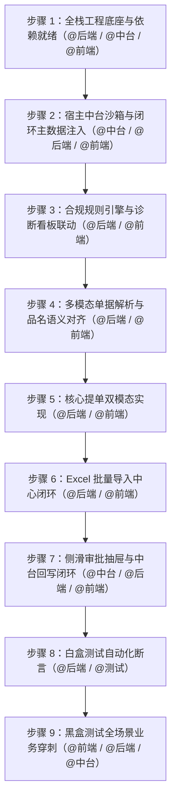

# TradeDoc AI 实施阶段指挥计划（循序渐进与测试闭环版）

## 一、 中台沙箱与闭环测试数据（确认冻结）
- **中台定位**：轻量级宿主容器沙箱（前端 1 个 ERP 订单列表页挂载助手，后端 5 个基础 Mock 接口），半天即可闭环。
- **闭环数据包**：
  - 合同池：远大钢铁（充足 ¥180万）、华夏石化（超额剩余 ¥4万）、中原特钢（过期）。
  - 物资黑话：螺纹钢（18螺纹）、中厚板（10个厚）、无缝管（57管）、高压闸阀（50闸阀）。
  - 穿刺 Case：Case A(合规通过)、Case B(高价预警特批)、Case C(超额阻断)、Case D(黑话对齐)、Case E(批量表格)。

---

## 二、 9 步循序渐进指挥流程（标注调用对话）

| 步骤编号 | 阶段里程碑 | 负责调用的对话智能体 | 协同并行工作包（不冲突并行） | 准出判定标准 |
| :--- | :--- | :--- | :--- | :--- |
| **步骤 1** | **全栈工程底座与依赖就绪** | **@[conversation:"后端"]** **@[conversation:"中台"]** **@[conversation:"前端"]** | **【后端】**FastAPI 分层架构、CORS、异常处理、MongoDB/Milvus 连接池与健康探针 (`GET /health`)。 **【中台】**Mock ERP FastAPI 脚手架、MongoDB 驱动与健康检查探针。 **【前端】**Vite + React 18 + TailwindCSS 骨架，Apple HIG tokens、Axios 拦截器与基础路由。 | 三端无报错启动，数据库心跳检查 100% 连通。 |
| **步骤 2** | **宿主中台沙箱与主数据注入** | **@[conversation:"中台"]** **@[conversation:"后端"]** **@[conversation:"前端"]** | **【中台】**实现订单台账、合同、物料 5 组 Mock API 与回写/回调通知。 **【后端】**编写并执行 Seed 脚本，将 3 家合同、4 类物资/黑话写入 MongoDB，向量写入 Milvus。 **【前端】**实现模拟 ERP 订单列表页（沙箱）+ 合同与字典配置页（`master_data.pen` 落地）。 | 中台列表可查合同与物料，沙箱页面成功挂载。 |
| **步骤 3** | **合规规则引擎与看板联动** | **@[conversation:"后端"]** **@[conversation:"前端"]** | **【后端】**实现物料匹配、价格偏离、合同超额、效期阻断 4 类硬合规规则引擎。 **【前端】**实现合规状态诊断卡片、风险提示指示器（正常绿/预警黄/阻断红）。 | 规则判定准确率 100%，前端能正确呈现三态诊断。 |
| **步骤 4** | **多模态单据解析与语义对齐** | **@[conversation:"后端"]** **@[conversation:"前端"]** | **【后端】**接入 PDF/图片 OCR 提取服务 + Milvus 向量相似度模糊品名推荐 API。 **【前端】**实现单据上传/预览组件、要素高亮选框与多轮对话气泡组件。 | 上传单据可识别商品明细，黑话品名置信度对齐标准字典。 |
| **步骤 5** | **核心提单双模态落地** | **@[conversation:"后端"]** **@[conversation:"前端"]** | **【后端】**提单草稿 CRUD、字段智能修改、草稿持久化与正式提交 API。 **【前端】**落地 `workbench.pen` 全屏工作台（左单据右表单联动）与 `floating_widget.pen`（56px 悬浮球 + 420px 面板）。 | 全屏与悬浮两端提单数据无缝互通，草稿编辑实时响应。 |
| **步骤 6** | **Excel 批量导入中心闭环** | **@[conversation:"后端"]** **@[conversation:"前端"]** | **【后端】**Excel 流式解析引擎，逐行穿透合规规则校验并返回错误行明细。 **【前端】**落地 `batch_import.pen` 批量导入中心（模板下载、拖拽上传、进度条、行级异常纠错）。 | 导入 5 行混合单据能准确定位异常行并在前端原位修改。 |
| **步骤 7** | **侧滑审批抽屉与回写联动** | **@[conversation:"中台"]** **@[conversation:"后端"]** **@[conversation:"前端"]** | **【中台】**接收特批审批通知与订单状态变更，执行配额原子扣减。 **【后端】**特批申报流转接口与中台回写同步触发。 **【前端】**落地 `order_detail_drawer.pen`，调起抽屉审批后无刷新更新中台状态。 | 审批通过后，ERP 列表状态即时刷新，合同额度准确扣减。 |
| **步骤 8** | **白盒测试（自动化断言）** | **@[conversation:"后端"]** @[conversation:"QA测试"] | **【后端/测试】**使用 Pytest 编写自动化白盒测试集：覆盖 8 组契约接口 DTO 校验、5 类规则边界值、超额阻断与理由拦截、配额扣减并发原子性。 | 所有白盒测试用例 100% PASS，覆盖率无死角。 |
| **步骤 9** | **黑盒测试与全场景穿刺** | **@[conversation:"前端"]** **@[conversation:"后端"]** **@[conversation:"中台"]** | **【端到端验收】**真实业务闭环穿刺：Case A(正常拍照提单)、Case B(高价预警特批)、Case C(超额拦截)、Case D(黑话匹配)、Case E(批量表格纠错) 及 UI 纯业务语言审查。 | 2.10 需求全场景 100% 闭环穿刺，交付达标。 |
