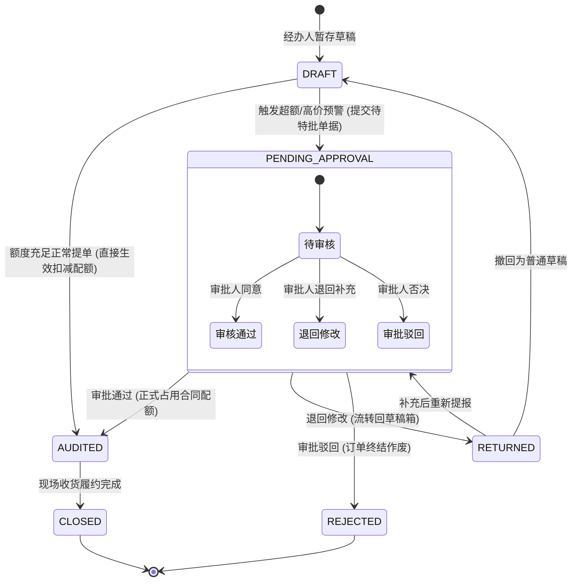
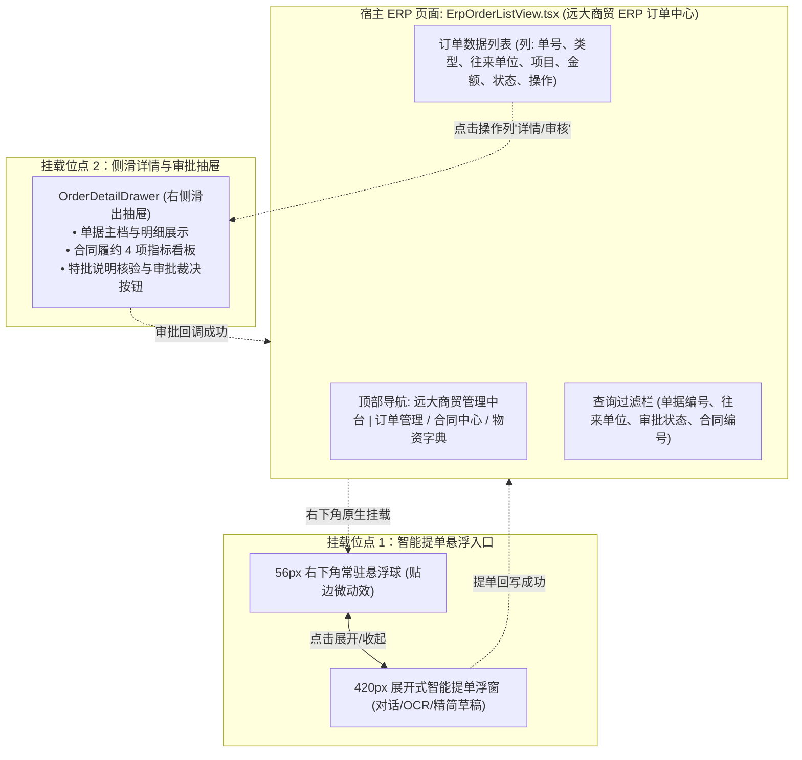

# 模拟中台业务沙箱 (Mock ERP) 架构与技术设计规约

| 文档版本 | 状态 | 编写人 | 适用范围 | 密级 |
| :--- | :--- | :--- | :--- | :--- |
| v1.0.0 | 正式发布 | 系统架构师 (Architect Agent) | TradeDoc AI 提单助手与宿主 ERP 中台沙箱联调 | 内部公开 |

---

## 一、中台定位与设计目标

### 1.1 系统定位
**模拟中台沙箱 (Mock ERP)** 模拟大宗商贸流通核心系统（如“远大商贸 ERP”），作为 TradeDoc AI 智能提单助手的**外部宿主与业务底座**。
它承载真实商贸订单台账、合同履约配额与物料主数据，并为前端提供真实的 ERP 订单列表管理页面作为助手挂载容器。

### 1.2 极简实用设计原则
1. **拒绝过度设计**：不引入复杂微服务拆分、分布式事务与多级消息总线，直接基于现有 MongoDB 存储与 FastAPI/RESTful 接口快速闭环。
2. **功能闭环完备**：完整包含订单主档、合同履约台账、物资字典、状态机流转、提单回写与审批回调接口。
3. **前端天然挂载**：在 ERP 订单列表页原生预留右下角 56px 悬浮提单球与侧滑订单详情/审批抽屉位点。

---

## 二、中台核心数据模型设计 (MongoDB)

### 2.1 中台订单主表 (`erp_orders`)
记录中台正式采销单据台账，支撑经办提单回写与审批状态变更：

```json
{
  "_id": "ObjectId",
  "order_no": "XSDD-YD-20260928-001",
  "source_draft_id": "DFT-20260928-001",
  "order_type": "SALES",
  "contract_no": "2026-WZ-089",
  "counterparty_name": "中建八局第一建设有限公司",
  "project_name": "科技城数字经济产业园一期项目",
  "delivery_address": "苏州市高新区科技城 1 号工地物资中转站",
  "contact_person": "张总 13912345678",
  "items": [
    {
      "item_seq": 1,
      "material_code": "STL-RB-400E-20",
      "material_name": "热轧带肋钢筋",
      "specification": "HRB400E Φ20mm",
      "quantity": 200.0,
      "unit": "吨",
      "unit_price": 4000.00,
      "total_amount": 800000.00
    }
  ],
  "total_amount": 800000.00,
  "erp_status": "PENDING_APPROVAL",
  "is_special_approved": true,
  "special_approval_reason": "现场工期提前追加采购",
  "operator_name": "李强",
  "operator_dept": "物资贸易一部",
  "approver_name": null,
  "approval_comment": null,
  "created_at": "2026-09-28T03:00:00Z",
  "updated_at": "2026-09-28T03:00:00Z"
}
```

*索引*：
- `{"order_no": 1}`（唯一索引）
- `{"contract_no": 1, "erp_status": 1}`
- `{"operator_dept": 1, "created_at": -1}`

---

### 2.2 合同履约台账 (`erp_contracts`)
履约核验与超额风控的事实来源：

```json
{
  "_id": "ObjectId",
  "contract_no": "2026-WZ-089",
  "contract_name": "科技城项目大宗钢材采销年度合同",
  "counterparty_name": "中建八局第一建设有限公司",
  "project_name": "科技城数字经济产业园一期项目",
  "total_amount": 5000000.00,
  "accumulated_amount": 4850000.00,
  "remaining_amount": 150000.00,
  "max_orders": 20,
  "accumulated_orders": 18,
  "remaining_orders": 2,
  "status": "ACTIVE",
  "valid_until": "2026-12-31"
}
```

*字段核算约束*：
- $\text{remaining\_amount} = \text{total\_amount} - \text{accumulated\_amount}$
- $\text{remaining\_orders} = \text{max\_orders} - \text{accumulated\_orders}$

---

### 2.3 物资与行话/简称字典 (`erp_materials`)
用于标准品名与现场“黑话/俗称”映射：

```json
{
  "_id": "ObjectId",
  "material_code": "STL-RB-400E-20",
  "material_name": "热轧带肋钢筋",
  "specification": "HRB400E Φ20mm",
  "category": "建筑钢材",
  "unit": "吨",
  "guide_price": 4000.00,
  "aliases": ["18螺纹", "20螺纹", "400E 20圆钢", "20厘螺纹钢", "三级螺纹钢20"]
}
```

---

## 三、中台订单状态机流转设计



### 状态变更业务动作矩阵：
| 触发事件 | 原始状态 | 目标状态 | 合同额度动作 | 通知联动 |
| :--- | :--- | :--- | :--- | :--- |
| **常规提单** | `DRAFT` | `AUDITED` | 原子扣减合同可用金额与可用笔数 | 即刻回写 ERP 订单列表首行 |
| **特批申报** | `DRAFT` | `PENDING_APPROVAL` | 暂不扣减额度，打上超额与待审标记 | 生成 ERP 待办单据，推入审批流 |
| **特批通过** | `PENDING_APPROVAL` | `AUDITED` | 正式扣减合同超额配额 | 广播更新状态，ERP 订单列表更新为已生效 |
| **特批退回** | `PENDING_APPROVAL` | `RETURNED` | 不占用额度 | 退回经办人工作台，ERP 标记退回 |
| **特批驳回** | `PENDING_APPROVAL` | `REJECTED` | 不占用额度，配额无损 | 单据终结作废，ERP 标记已驳回 |

---

## 四、提单回写与审批回调通知机制

### 4.1 提单回写接口 (TradeDoc -> ERP)
提单助手完成提单后，主动向中台同步订单主档并持久化。

- **端点**：`POST /api/erp/orders/writeback`
- **请求体 (OrderWritebackDTO)**：
  ```json
  {
    "source_draft_id": "DFT-20260928-001",
    "order_type": "SALES",
    "contract_no": "2026-WZ-089",
    "counterparty_name": "中建八局第一建设有限公司",
    "project_name": "科技城数字经济产业园一期项目",
    "delivery_address": "苏州市高新区科技城 1 号工地物资中转站",
    "contact_person": "张总 13912345678",
    "items": [
      {
        "item_seq": 1,
        "material_code": "STL-RB-400E-20",
        "material_name": "热轧带肋钢筋",
        "specification": "HRB400E Φ20mm",
        "quantity": 200.0,
        "unit": "吨",
        "unit_price": 4000.0,
        "total_amount": 800000.0
      }
    ],
    "total_amount": 800000.0,
    "is_special_approved": true,
    "special_approval_reason": "现场工期提前追加采购",
    "operator_name": "李强",
    "operator_dept": "物资贸易一部"
  }
  ```
- **中台响应**：
  ```json
  {
    "code": 200,
    "message": "中台订单回写成功",
    "data": {
      "order_no": "XSDD-YD-20260928-001",
      "erp_status": "PENDING_APPROVAL",
      "created_at": "2026-09-28T03:00:00Z"
    }
  }
  ```

---

### 4.2 审批裁决回调通知 (TradeDoc -> ERP)
在侧滑抽屉或审批工作台完成特批裁决后，通知中台更新订单状态机并更新合同配额。

- **端点**：`POST /api/erp/orders/{order_no}/callback`
- **请求体 (ApprovalCallbackDTO)**：
  ```json
  {
    "decision": "PASS", // 可选: PASS | RETURN | REJECT
    "approver_name": "王总",
    "approval_comment": "经核实工程进度属实，同意追加发运。",
    "approval_time": "2026-09-28T03:30:00Z"
  }
  ```
- **中台响应**：
  ```json
  {
    "code": 200,
    "message": "审批回调处理成功，中台订单状态已更新",
    "data": {
      "order_no": "XSDD-YD-20260928-001",
      "erp_status": "AUDITED",
      "accumulated_contract_amount": 5650000.0
    }
  }
  ```

---

## 五、前端宿主容器挂载机制



### 联动机制设计：
1. **轻量全局事件通知**：提单助手回写成功或抽屉审批成功后，通过统一事件总线派发 `window.dispatchEvent(new CustomEvent('erp:order_refresh'))`。
2. **列表无刷新静默更新**：宿主列表组件监听该事件，局部重新请求 `GET /api/erp/orders`，使新单据立即呈现在列表首行并显示正确状态胶囊，体验顺滑连贯。

---

## 六、闭环 Seed 模拟数据集规约

严格按照《04_execution_plan_and_data_closure.md》确认的数据池进行注入，实现端到端 Case A~E 场景完美闭环：

### 6.1 3 家合同池 (`erp_contracts`)
| 合同编号 | 签约单位 | 关联合同工程 | 合同总额 | 累计已用 | 剩余额度 | 最大单数 | 剩余单数 | 状态 | 对应穿刺测试场景 |
| :--- | :--- | :--- | :--- | :--- | :--- | :---: | :---: | :---: | :--- |
| **`2026-WZ-089`** | 远大钢铁销售总公司 | 科技城数字经济产业园一期 | 500 万 | 485 万 | **15 万** | 20 | 2 | `ACTIVE` | **Case B / Case C**（超额预警与特批单提报） |
| **`2026-WZ-090`** | 华夏石化销售集团 | 苏州轨道交通 8 号线 3 标 | 1000 万 | 200 万 | **800 万** | 50 | 45 | `ACTIVE` | **Case A**（合规直接生效提单） |
| **`2025-WZ-012`** | 中原特钢实业有限公司 | 郑州保税物流仓储扩建工程 | 300 万 | 120 万 | 180 万 | 30 | 18 | `EXPIRED` | **效期阻断**（合同已过期拦截测试） |

### 6.2 4 类物资与现场黑话字典 (`erp_materials`)
| 标准物料编码 | 规范物资名称 | 规格型号 | 单位 | 指导单价 | 现场行业俗称/黑话列表 (`aliases`) | 对应测试场景 |
| :--- | :--- | :--- | :---: | :---: | :--- | :--- |
| **`STL-RB-400E-20`** | 热轧带肋钢筋 | HRB400E Φ20mm | 吨 | 4,000.00 | `["18螺纹", "20螺纹", "400E 20圆钢", "20厘螺纹钢"]` | **Case D**（口语/手写简称向量检索纠错） |
| **`STL-PL-Q235-10`** | 普碳钢板 | Q235B 10*1500*6000 | 吨 | 4,200.00 | `["10个厚", "Q235中板", "10厘板", "10厚普板"]` | **Case D**（厚度黑话近似对齐） |
| **`PIP-SM-20G-57`** | 无缝钢管 | 20G Φ57*3.5 | 米 | 120.00 | `["57管", "20G无缝管", "57无缝钢管", "57小口径管"]` | **Case E**（Excel 批量管材导入） |
| **`VLV-GT-Z41H-50`** | 铸钢法兰闸阀 | Z41H-16C DN50 | 台 | 360.00 | `["50闸阀", "高压50法兰闸阀", "DN50铸钢闸阀"]` | **Case E**（阀门配件批量导入） |

---

## 七、架构准出核验说明

- **中台定位明确**：完整抽象出模拟 ERP 系统的订单表、合同台账、物料字典与状态机。
- **双向联动闭环**：详尽定义提单回写（Writeback）与审批回调（Callback）接口及前端无刷新更新机制。
- **零过度设计**：接口与模型直接采用标准 JSON 契约与 MongoDB 单表持久化，易于在半天内完成编码与联调闭环。
